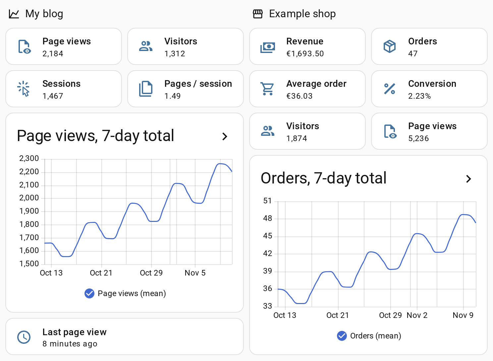

# Looku for Home Assistant

The official Home Assistant integration for [Looku](https://github.com/niemenjoki/looku), made by the author of
Looku.

> [!NOTE]
> Tested with Looku 0.9 and Home Assistant 2026.10. Please report problems in
> [Issues](https://github.com/niemenjoki/ha-looku/issues).

Page views, visitors and shop sales of your Looku sites as Home Assistant sensors. Looku is self-hosted web
analytics that your site's server records; this integration reads its totals through Looku's read API. Installs
through HACS and needs only a read key.

<picture>
  <source media="(prefers-color-scheme: dark)" srcset="https://raw.githubusercontent.com/niemenjoki/ha-looku/main/docs/dashboard-dark.png">
  
</picture>

The example cards from [`examples/`](examples/), with built-in Home Assistant cards only and made-up numbers.

## Features

- Every site as its own device: page views, visitors, sessions and pages per session for the period you choose
  (last 24 hours, 7 days, 28 days, 3 months or 12 months).
- Shop sites (the `shop` module on): orders, revenue, average order and conversion, in the shop's currency.
- When page views last arrived, per site and for all your sites: notice when a site's connector stops sending.
- Read only: the integration never changes Looku's settings or keys, and it talks only to your own Looku.
- New sites, and the shop module turned on later, get their sensors automatically.
- Ready-made dashboard cards that use only built-in cards.

## Entities

The names of the totals end with the period, for example `Page views 7d`. The attributes `from` and `to` give the
days the totals cover; for the last 24 hours, `since` and `until` give the exact times.

| Device | Sensor | Notes |
|---|---|---|
| Site | Page views, Visitors, Sessions, Pages per session | Visitors, sessions and pages per session are *unknown* when the site counts no visitors (`site:visitors off`). |
| Site | Last page view | Time of the site's newest page view (diagnostic). |
| Site with the shop module | Orders, Revenue, Average order, Conversion | Revenue and average order use the currency set in Looku's shop settings; without one they are plain numbers. Conversion is *unknown* when the site counts no visitors. |
| Looku server | Last page view | Newest page view of the sites the key can read (diagnostic). |

The integration polls Looku every 10 minutes. The totals are the same numbers the Looku dashboard shows for the
period.

## 1. Let Home Assistant reach Looku

The read API is on the dashboard's address, so Looku's dashboard rules apply to Home Assistant too. In Looku's
`.env`:

- `LOOKU_DASHBOARD_BIND`: by default the dashboard listens only on `127.0.0.1`. If Home Assistant runs on another
  machine, set the server's LAN address here, e.g. `192.168.1.10`.
- `LOOKU_API_HOSTS`: if set, add the address you will enter in Home Assistant, e.g. `192.168.1.10:8788`. Otherwise
  Looku answers `421 Unknown host`.
- `LOOKU_API_ALLOW`: if set, add Home Assistant's IP address. Otherwise Looku answers `403 Forbidden`.

Restart Looku after changing `.env` (`docker compose up -d`).

## 2. Create a read key

In the Looku dashboard settings, or on the server:

```bash
docker compose run --rm ingest token:create homeassistant --scope read
```

It prints a key that starts with `lk_` once; copy it. Add `--site <site id>` to limit the key to one site: Home
Assistant then shows only that site.

## 3. Install the integration

1. In HACS, open the menu (⋮) > **Custom repositories**, add `https://github.com/niemenjoki/ha-looku` with type
   **Integration**, then download **Looku**.
2. Restart Home Assistant.
3. **Settings > Devices & services > Add integration > Looku.**
4. Enter the dashboard address, e.g. `http://192.168.1.10:8788`, and the key. Keep **Verify the SSL certificate**
   on unless your HTTPS address uses a self-signed certificate.

If the setup says Looku refused Home Assistant, check step 1. If it says the key cannot read any site, add a site in
Looku or use a key without `--site`.

### Options

**Settings > Devices & services > Looku > Configure** chooses the period. The default is the last 7 days. The
last 24 hours end now; the others end today in each site's time zone. The totals of another period are a different
quantity, so a new period gets new sensors (e.g. `sensor.my_blog_page_views_28d`) with their own history, and the
sensors of the old period are removed. Update your dashboards and automations after changing the period.

### Change the address or key

**Reconfigure** in the integration's menu changes the address and keeps the key if you leave it empty. When Looku
rejects the key (for example after you deleted it), Home Assistant asks for a new one.

## Examples

Ready-made cards with built-in Home Assistant cards only. Add one in a dashboard with **Edit dashboard > Add card >
Manual** and paste the file; replace the entity ids as the comments in the file say.

- [`examples/dashboard-site.yaml`](examples/dashboard-site.yaml): the totals of one site and a page view graph.
- [`examples/dashboard-shop.yaml`](examples/dashboard-shop.yaml): revenue, orders, average order and conversion of
  a shop next to its visits, and an order graph.
- [`examples/automation-no-page-views.yaml`](examples/automation-no-page-views.yaml): a notification when a site
  has had no page views for six hours.

The graphs use Home Assistant's long-term statistics of the totals, so they fill in day by day after you install the
integration.

## Development

```bash
pip install pytest-homeassistant-custom-component
pytest
```

The tests use saved Looku answers in `tests/fixtures/` with made-up sites and numbers.

## License

MIT, see [LICENSE](LICENSE).
